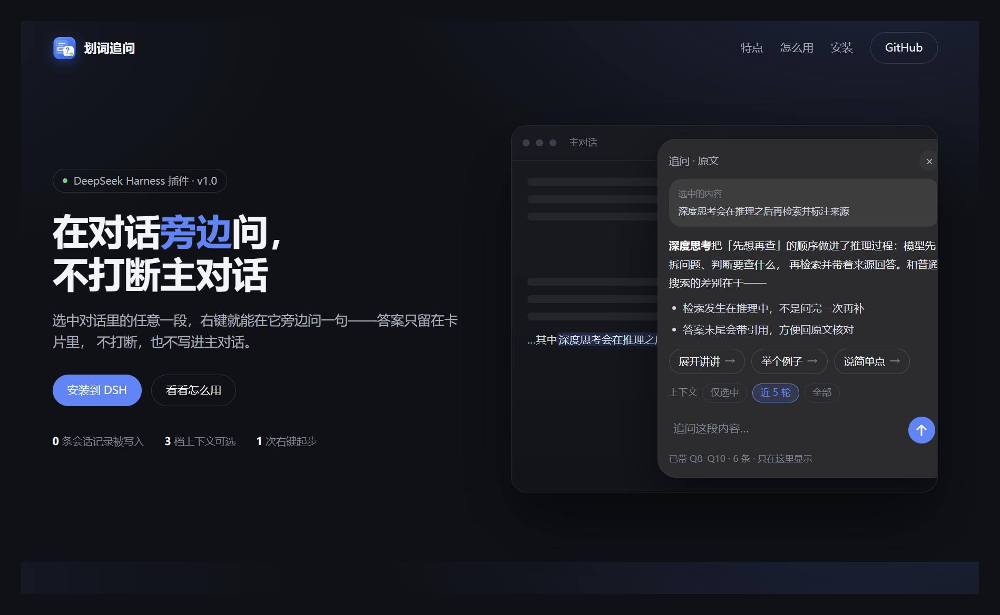

# 划词追问 · Selection follow-up

选中对话里的一段，右键在它旁边追问；答案只留在浮层卡片里，不写进主对话。



## 特点

- **不打扰**：浮层卡片贴着选区出现，不占侧栏、不压缩主界面、不新建会话、不写会话日志。
- **上下文可选**：仅选中（默认）/ 近 5 轮 / 全部，按 `Q1`、`Q2`… 编号带上，问“第 5 个问题”能对上。
- **回答可读**：Markdown 渲染、流式输出、可停止、失败可重试。
- **复制顺手**：卡片标题栏一点即复制原文。
- **跟壁纸插件共存**：装了 `dsh-plugin-wallpaper-engine` 时自动改用同款液态玻璃表面与强调色；没装时外观不变。

## 安装

1. **界面**：DSH「插件」页 → **添加插件** → 粘贴本目录的绝对路径 → 安装。
2. **命令行**：`dsh plugin add /path/to/selection-followup`

## 限制

- 纯问答：不能读文件、跑命令、调用工具。
- 选中文字与所选上下文会发给模型，走主对话同一条链路。
- 追问内容不落盘，关闭卡片即丢失。

## 开发

```bash
ELECTRON_RUN_AS_NODE=1 node test-host.mjs
ELECTRON_RUN_AS_NODE=1 node test-client.mjs
```

在线展示：<https://m0rningbreeze.github.io/dsh-selection-followup/>

## License

[MIT](LICENSE)
